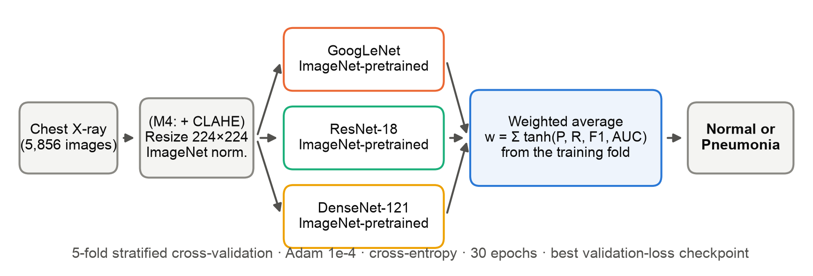
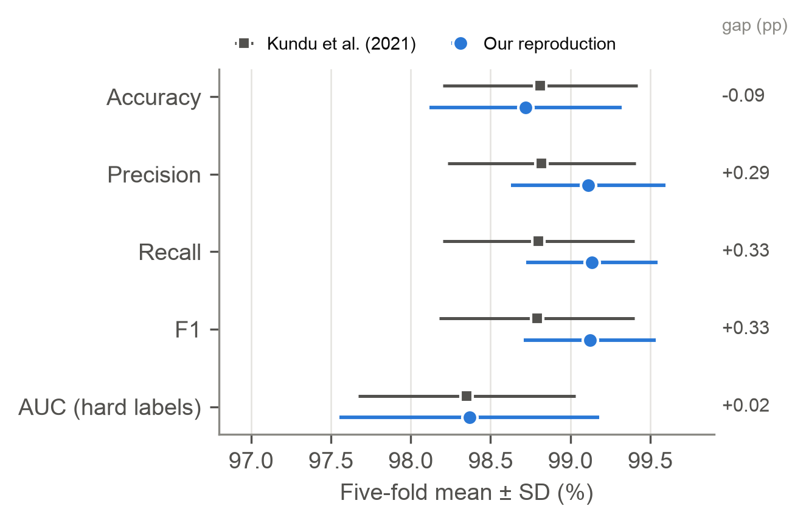

# Pneumonia Detection from Chest X-rays: Reproducing Kundu et al. (2021)

A research-reproduction project for the Computer Vision course at Newton School of Technology, Rishihood University.

**Team:** Aman Kumar (230065), Asmit (230063), Shashwat (230127)

We rebuilt the ensemble from Kundu et al., *"Pneumonia detection in chest X-ray images using an ensemble of deep learning models"* (PLOS ONE 16(9): e0256630, 2021). We trained it on the same data and compared our numbers with the paper's.

## What the method does

Three image models (GoogLeNet, ResNet-18 and DenseNet-121) each look at a chest X-ray and give a probability of pneumonia. The three probabilities are combined into one answer by a weighted average. Each model's weight is `tanh(Precision) + tanh(Recall) + tanh(F1) + tanh(AUC)`.

## Setup

| | |
|---|---|
| Dataset | Kermany pediatric chest X-rays: 5,856 images (1,583 Normal, 4,273 Pneumonia) |
| Evaluation | 5-fold stratified cross-validation (seed 42); per fold 4,216 train, 469 validation, 1,171 test |
| Training | Adam, learning rate 1e-4, 30 epochs, batch 16, 224×224, ImageNet weights, no augmentation |
| Hardware | Google Colab T4 GPU, with a checkpoint saved every epoch |

## Results (5-fold mean ± SD, %)

| Model | Accuracy | Precision | Recall | F1 | AUC |
|---|---|---|---|---|---|
| GoogLeNet | 98.58 ± 0.96 | 99.09 ± 0.56 | 98.97 ± 0.87 | 99.03 ± 0.66 | 99.78 ± 0.17 |
| ResNet-18 | 98.33 ± 0.73 | 98.94 ± 0.48 | 98.76 ± 0.53 | 98.85 ± 0.50 | 99.74 ± 0.16 |
| DenseNet-121 | 97.95 ± 0.76 | 98.65 ± 0.89 | 98.55 ± 0.92 | 98.59 ± 0.52 | 99.61 ± 0.17 |
| **Ensemble (ours)** | **98.72 ± 0.60** | **99.11 ± 0.49** | **99.13 ± 0.41** | **99.12 ± 0.41** | **99.84 ± 0.12** |
| Ensemble (paper) | 98.81 | 98.82 | 98.80 | 98.79 | 98.35 |

Every gap to the paper is smaller than one standard deviation.

## Key findings

1. **The AUC gap is a measurement difference.** The paper's code computes AUC from 0/1 predictions instead of probabilities, which gives balanced accuracy. Measured the same way, ours is 98.37 and theirs is 98.35.
2. **Healthy X-rays are misread more often.** 75 of 5,856 images were wrong. Normal images were wrong 2.40% of the time and Pneumonia images 0.87% of the time, about 2.8× more. The 2.7:1 class imbalance is the likely cause.
3. **Results vary by fold.** Ensemble accuracy ranges from 97.95% to 99.49% across folds. This 1.54-point spread is 17× our gap to the paper.
4. **The weights end up almost equal.** They are computed on training data, where every model is about 100% correct, so each weight is about 1/3. The ensemble then acts like a plain average. It beats the best single model in only 2 of 5 folds; its real benefit is stability.

## Proposed extension (CLAHE): status

Our hypothesis, written before coding, was that CLAHE (local contrast enhancement) applied before training would raise pneumonia recall and AUC without lowering F1. The planned experiments and their controls are implemented and tested in the notebook (§6.2–6.4, §8).

**These experiments have not been run yet**, because they need about 5–10 GPU-hours. The repository makes no claim about CLAHE results.

## Repository contents

| Path | What it is |
|---|---|
| `Pneumonia_Kundu_Reproduction_CLAHE.ipynb` | Main notebook: data, method, training engine, baseline results, CLAHE experiments and failure analysis |
| `Final_Submission/Project Report.pdf` | IEEE-format project report |
| `Final_Submission/IEEE_Report_LaTeX_Overleaf/` | LaTeX source of the report (IEEEtran; upload to Overleaf to compile) |
| `Final_Submission/Pneumonia Detection Reproduction.pdf` | Presentation slides |
| `Final_Submission/Presentation_Script_Slide_by_Slide.pdf` | Speaker script for the presentation |
| `Final_Submission/figures/` | Figures used in the report and slides |

## How to run

1. Open the notebook in Google Colab and pick a GPU runtime.
2. Run the cells in order. §2 downloads the Kermany dataset from Kaggle; it may ask for your Kaggle API token.
3. Checkpoints and predictions are saved to Google Drive, so training resumes after a disconnect. Training all three models on all five folds takes several GPU-hours.

## Limitations

- One dataset: children aged 1–5 from one hospital group.
- Data was split by image, not by patient, so images of the same child may appear in both train and test.
- The patient-leakage audit, Grad-CAM and subtype analysis are written but not yet run.
- This is a research reproduction, not a clinical tool.

## Reference

R. Kundu, R. Das, Z. W. Geem, G.-T. Han and R. Sarkar, "Pneumonia detection in chest X-ray images using an ensemble of deep learning models," *PLOS ONE*, vol. 16, no. 9, e0256630, 2021.
